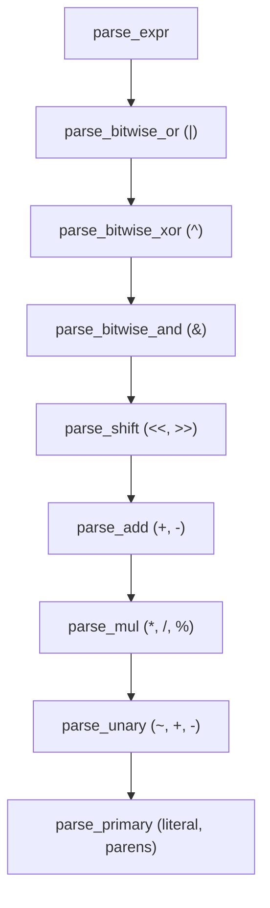
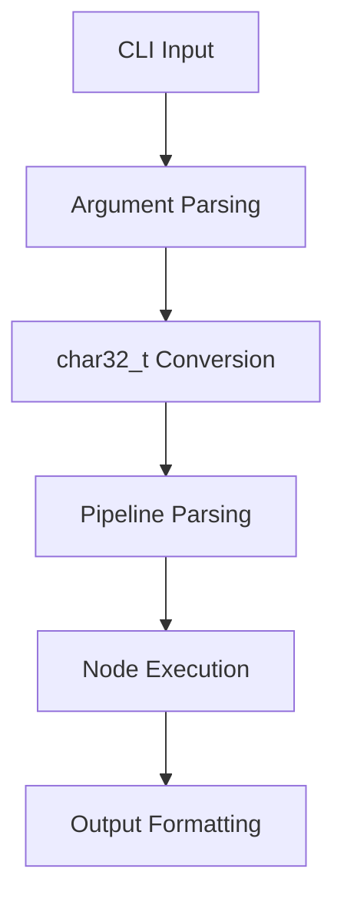

# Ashift Architecture

This document explains the structural design and engineering principles behind Ashift.

## Files

- `shift.h` — Header with type definitions, operation constants, and data structures.
- `shift.c` — Core parsing engine containing the recursive descent expression parser and command parser.
- `main.c` — Entry point handling argument processing, operation execution, and output formatting.
- `Makefile` — Build system supporting Linux/Mac native builds and Windows cross-compilation.

## Data Structures

The core data structures are defined in `shift.h`:

- `shift_val_t`: A union holding typed values (u8, u16, u32, i8, i16, i32).
- `shift_node_t`: A linked list node representing an operation. It contains:
  - `flags`: A 32-bit integer packing the opcode, type, and validity status.
  - `op_arg`: The argument for the operation.
  - `target_val`: The target value to operate on.
  - `next`: A pointer to the next node in the pipeline.
- `shift_pipeline_t`: Represents a sequence of operations with `head` and `tail` pointers, plus a `free_head` for the freelist allocator.
- `shift_ctx_t`: The context struct holding the raw command string, a pointer to the pipeline, and output/error buffers.

## Flag Packing Scheme

The `flags` field in `shift_node_t` is a `uint32_t` packed as follows:
- **Bits 0-7**: Opcode (`SHIFT_OP_LSHIFT=0x01`, `RSHIFT=0x02`, `AND=0x03`, `OR=0x04`, `XOR=0x05`, `NOT=0x06`).
- **Bits 8-15**: Data type.
- **Bit 16**: `FLAG_VALID`.

## Expression Parser

`shift.c` implements a recursive descent parser for expressions, evaluating standard operator precedence.

The parser supports decimal and hexadecimal (e.g., `0xFF`) literals.

## Command Parsing

The `shift_parse_pipeline` function processes the full command string. The parsing sequence is:
`opcode` → `op_arg expression` → `type descriptor` → `value expression`

Multiple instructions can be chained using the `&` separator.

## Memory Model

Ashift uses a stack-allocated memory model with no dynamic memory allocation (`malloc`/`free`). 
A pre-allocated pool of 10 `shift_node_t` structs is defined in `main.c` (`nodes_pool`). Pipeline nodes are allocated from this pool using a freelist allocator.

## Performance Approach

Performance optimizations include:
- `FORCE_INLINE` macros on hot path functions.
- `LIKELY`/`UNLIKELY` macros for branch prediction hints.
- Bitwise arithmetic for decimal parsing: `val = (val << 3) + (val << 1) + digit` instead of integer multiplication `val * 10`.
- Custom `print_u32` and `print_str` functions to avoid `printf` overhead.
- Aggressive compiler flags: `-O3 -march=native -flto -fomit-frame-pointer`.

## Execution Flow

1. Parse CLI arguments and check for `-h`/`--help`.
2. Concatenate `argv` into `raw_input` and convert it to a `char32_t` buffer.
3. Initialize the node pool and pipeline struct.
4. Call `shift_parse_pipeline` to parse the command into pipeline nodes.
5. Walk the pipeline linked list, execute each operation, and print results with binary visualization.
